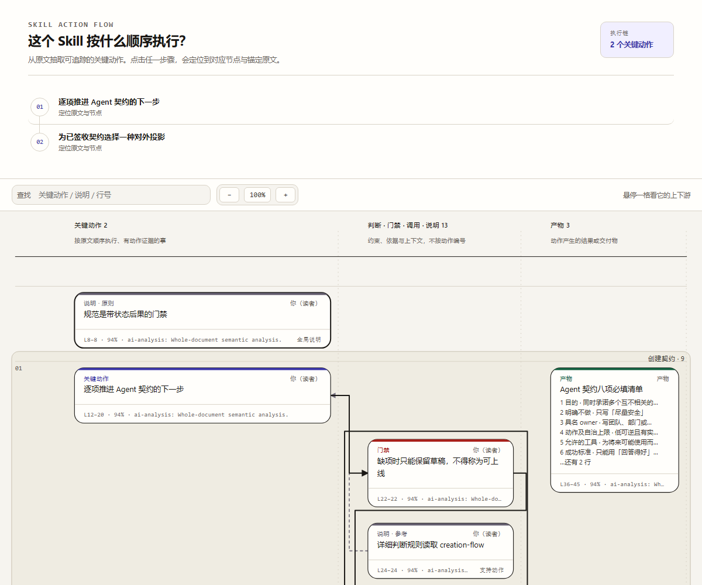
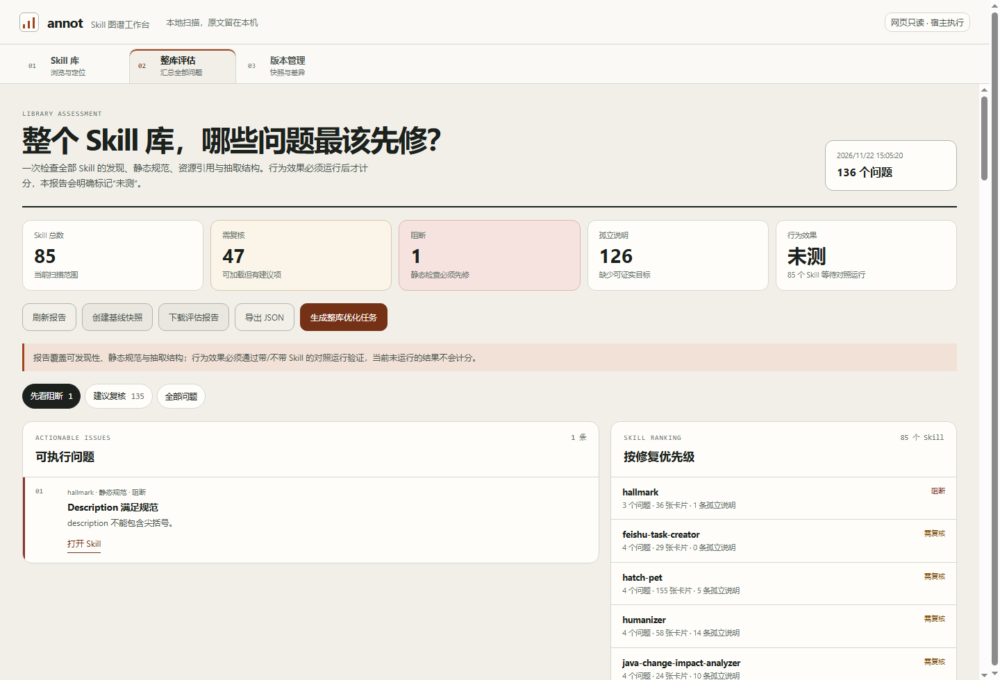
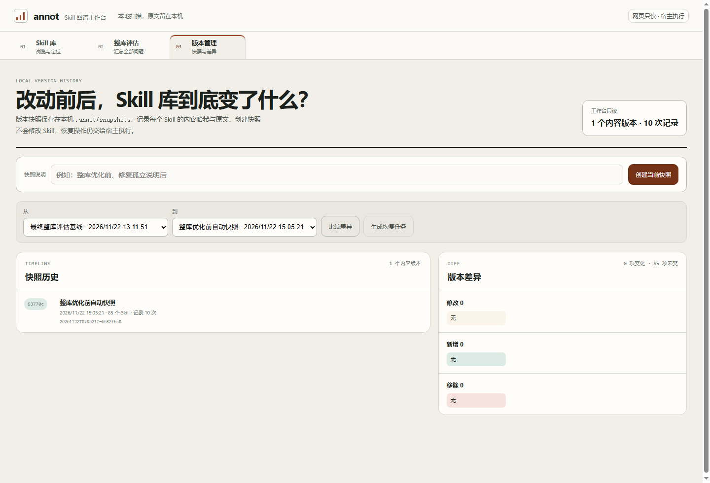
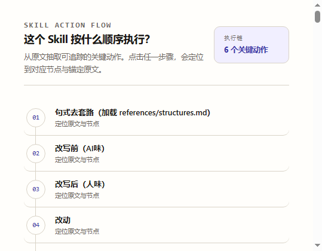
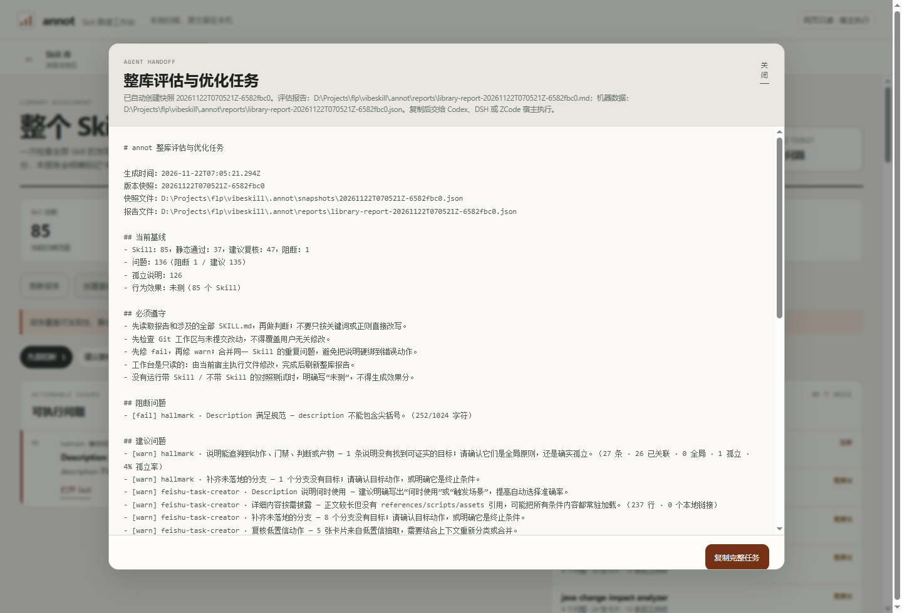

# annot

**Inspect, evaluate, and optimize Agent Skills across tools.**<br>
把 `SKILL.md` 拆成带源码锚点的动作图，汇总整库问题，生成宿主 Agent 可执行的优化任务，并保存可比较的版本快照。

[](#快速开始)
[](https://nodejs.org/)
[](#隔离测试)
[](#设计约束故意不做的事)
[](LICENSE)

> 一个 Skill 引擎，多种宿主外壳。Codex、DSH、ZCode 与独立网页共享同一套扫描、分析、校验和评估代码。

## 目录

- [界面预览](#界面预览)
- [多工具支持](#多工具支持)
- [核心能力](#核心能力)
- [0.2.0 改了什么](#020-改了什么)
- [快速开始](#快速开始)
- [从自然语言到评估闭环](#从自然语言到评估闭环)
- [AI-first 语义分析](#ai-first-语义分析)
- [命令](#命令)
- [开发与验证](#开发与验证)

## 界面预览



| 整库评估 | 版本管理 |
|---|---|
|  |  |

| 动作链 | 宿主优化任务 |
|---|---|
|  |  |

## 多工具支持

| 工具 | 接入方式 | 当前能力 |
|---|---|---|
| **Codex** | [Codex 插件](plugins/annot)、3 个 Skill、独立 Reviewer Agent | 浏览动作图、检查规范、生成分析与评估任务、打开统一工作台 |
| **DeepSeek Harness (DSH)** | [原生 DSH bundle](plugin/)，侧栏面板 + 主区页面 | 共用 annot CLI、定位节点、生成改写上下文、打开独立工作台 |
| **ZCode** | [ZCode 插件](plugins/annot-zcode) 与本地 marketplace | 3 个 Skill、`open-workbench` 命令、统一工作台入口 |
| **Claude Code / Cursor / GitHub Copilot / Gemini CLI / OpenCode** | 默认扫描对应项目与用户 Skill 目录 | 自动发现、搜索、动作图、规范检查与整库报告 |
| **独立网页** | `annot workbench open` | 本机运行、只读扫描、整库报告、版本快照与宿主任务 |

## 核心能力

- **源码锚定**：每张动作卡绑定精确行范围与行哈希，图可以追溯到原文。
- **AI-first 分析**：AI 判断动作、门禁、判断、产物与说明关系；CLI 负责契约校验和确定性渲染。
- **规范与评估分离**：加载规范、本地引用、孤立说明和结构问题可直接检查；行为效果必须运行 baseline 与 Skill 对照后才计分。
- **诊断 → 修复任务**：未通过项直接变成带逐字摘录、行号和验收条件的宿主修复任务；`annot repair` 与网页三处入口调用同一份文本。
- **整库评估**：一次汇总全部 Skill 的阻断和建议问题，支持筛选及 Markdown/JSON 报告导出。
- **优化任务回环**：自动建立优化前快照，生成带报告路径、问题清单和验收要求的 Codex/DSH/ZCode 任务。
- **版本管理**：保留 Skill 原文与内容哈希，按内容指纹合并重复记录，比较新增、修改和移除项。
- **本地优先**：工作台只监听 `127.0.0.1`，不上传 Skill 内容，也不在浏览器里直接写 Skill 源文件。

## 0.2.0 改了什么

这一版把「看」和「改」之间的断点补上了，并且把图彻底交给 AI 分析：

- **动作图只由 AI 分析生成**。网页不再在没有分析时静默回退到关键词草案；`annot annotate` 没有 `--analysis` 直接拒绝，`--rules` 只能显式索要。`annot analyze` 一条命令写出分析任务，打印的就是工作台读取的那个提案路径——两处路径曾经不一致，导致分析写成功、页面照样空白。
- **分析过期会被明确指出**。改过 `SKILL.md` 后旧提案的源 hash 对不上，网页显示「语义分析已过期」并给出两版 sha，`annot annotate` 报 `source hash mismatch`；此前它落到通用 400，页面只说 `invalid request`。修复任务的验收里写明：改完必须重做分析，因为锚点是按旧字节算的。
- **诊断可直接转成修复任务**。`annot repair` 与 `POST /api/brief { mode: "repair" }` 输出同一份文本，每项带当前原文的逐字摘录、行号、改法和可复跑的通过条件；没定位到行的检查明说「位置未定位」，不许猜。
- **泳道是布局的一部分**。`lane` 不再只印在卡片角上：工具与读者步骤进动作列，门禁与说明进上下文列，连续同泳道成带并标人数。
- **工作台是后台进程，所以要认代码指纹**。`GET /api/status` 报 `build`，`annot workbench status` 同时报 `currentBuild`，指纹不符时 `workbench open` 自动重启受管实例——「改了没生效」从此只有两种答案：旧进程或真 bug。

完整的分轮记录见 [`docs/00-status.md`](docs/00-status.md)。

---
## 为什么源码锚点重要

很多 Skill 可视化工具只能从 Markdown 文本中**猜**结构，结果难以复现、diff，也不容易判断改动影响了哪些节点。

annot 的差别只有一件事：**每个节点都锚死在 SKILL.md 的具体行上，并且记住那几行的哈希。**

```
node.anchor = { heading: [...], start: 65, end: 72, sha: "a3f1…" }
```

annot 由此支持三项可验证操作：

1. **判断"这个 skill 对吗"**：图上的每个框都能点回原文，不用再猜是哪个段落教的。
2. **判断"我改对了吗"**：`annot check` 拿新文件重新算哈希，报"哪几个节点漂移了、移到哪一行"。没改的节点一定不报——这是它可信的唯一理由。
3. **用自然语言改**：锚点给定行范围，改一句话就只动那几行，不会整篇重写。

---

## 快速开始

从源码运行：

```bash
git clone https://github.com/tataCrayon/annot.git
cd annot
npm link
annot workbench open
```

工作台默认扫描 Codex、Claude Code、Cursor、GitHub Copilot、Gemini CLI、OpenCode、DSH 与 ZCode 的常见 Skill 目录。也可以先用 CLI 标注单个 Skill：

```bash
# 动作图只能由 AI 语义分析生成，所以第一步是拿到分析任务
annot analyze path/to/my-skill
#   写出 .annot/my-skill/analysis-task.md，并打印 AI 结果要保存的路径：
#   .annot/analyses/my-skill.analysis.json（工作台默认读这个目录）

# 宿主 AI 读完任务把 JSON 写到那个路径后，验证并渲染图
annot annotate path/to/my-skill \
  --analysis .annot/analyses/my-skill.analysis.json \
  --out .annot/my-skill-graph

# 得到两个文件
#   .annot/my-skill-graph/my-skill.flow.json   ← 数据，可进 git
#   .annot/my-skill-graph/my-skill.html        ← 单文件，双击即开，无网络无依赖

# 改完 SKILL.md 后检查锚点是否还成立
annot check .annot/my-skill-graph/my-skill.flow.json --skill path/to/my-skill/SKILL.md
```

改过源文件后，旧的分析提案会因源 hash 不匹配被拒绝（`annot annotate --analysis` 报 `source hash mismatch`，网页显示「语义分析已过期」）。这是设计：节点锚点指向的字节已经变了。重做一次 `annot analyze` + `annot annotate` 就恢复。

不带 `--analysis` 的 `annotate` 会拒绝执行：图的节点、顺序和泳道都由分析给出，规则草案在屏幕上和真分析长得一样，所以它不再作为默认或兜底。迁移与回归需要旧规则时显式加 `--rules`。

`check` 的退出码就是结论：`0` 全部同步，`1` 有漂移（并逐条列出 `node id`、`moved 65 → 67` 或 `broken`）。

```bash
# 列出某个根目录下所有 skill（按 name 去重，低 rank 优先）
annot list ~/.agents/skills ./.agents/skills

# 批量体检：哪些 skill 抽得不好
annot audit ~/.agents/skills ./skills --limit 15

# 让 agent 改某个节点：交出精确行范围 + 原文 + 约束
annot context .annot/my-skill/my-skill.flow.json n-state
```

`audit` 是产品命令而不是开发工具——"我的哪个 skill 渲染得不对"本来就是这个工具要回答的问题。
它按加权分排序（空标签 ×10、空正文 ×5、未绑定分支 ×2、低置信 ×1、过拆密度），并把 0 分澄清单列出来：

```
36 个 skill，2 个零瑕疵

 score  nodes  low  unres  junk  skill
  13.0     19    1      6     0  comprehension-ledger
  10.0     77    4      3     0  spec-verifier
```

`context` 是"用自然语言改"这一环的接缝。annot 自己不调模型——**宿主 agent 就是模型**，它缺的不是理解力，而是"该动哪几个字节"。所以这里只交三样东西：精确到行的原文、前后邻居、以及防止图被改坏的硬约束（不改范围外、不动标题、不插前置空行）。

```
## 原文（请在此基础上改）
> Treat every method as guilty until proven deliberate and superior. …

## 约束
- 只改第 13–15 行（1-based，含首尾）。
- 不要改动本范围之外的任何行…
- 这是门禁节点：保留命令式语气与"必须/禁止"这类硬约束词，不要改写成建议。
```

## 从自然语言到评估闭环

网页负责把意图整理成受控任务，Codex、DSH 或 ZCode 宿主负责执行。这样既可以从自然语言开始，也不必让页面偷偷写入源文件。

### 修改一个节点

1. 在工作台打开 Skill，点标题旁的「自然语言修改」直达当前节点；也可点图上的节点，或从「节点上下文」换一个节点。
2. 用一句话写意图，例如“先检查未提交改动，发现问题就停下来询问”。
3. 点「生成修改任务」，复制完整任务交给 Codex 或 DSH。
4. 宿主先保存 flow 快照，只改锚定行；修改后运行 `annot check`，返回 diff、锚点变化和未解决风险。

任务会带上原文、行号、哈希、范围外禁止修改等约束，所以“自然语言修改”不会退化成整篇重写。

### 规范检查

“规范与评估”页签会检查当前 Skill 的名称、Description、正文结构、渐进披露、本地引用和维护性。`annot review` 提供同一套确定性结果：

```bash
node src/cli.ts review path/to/my-skill
node src/cli.ts review path/to/my-skill --json
```

有阻断项时命令退出 `1`，只有建议项时退出 `0`。这部分回答“Skill 是否符合规范、是否容易被加载”，不回答“Skill 是否有效”。行为效果仍要通过下一节的隔离对照实验验证。

### 从诊断直接生成修复任务

诊断出问题之后，下一步不该是“再生成一份评估任务”。`annot repair` 把每一条未通过项变成可执行的修复任务：它引用**当前原文的逐字摘录和行号**，给出这一项的改法，并写死验收条件（`annot review` 里该项变成 pass，且没有别的项退化成 fail）。

```bash
node src/cli.ts repair path/to/my-skill                      # 全部未通过项
node src/cli.ts repair path/to/my-skill --check note-coverage # 只修一项
node src/cli.ts repair path/to/my-skill --json                # 机器可读
```

三条硬约束写在任务里，因为它们是修复最容易走偏的地方：

- **不编造位置**：检查项没定位到行时，任务明说“位置未定位”，要求宿主先 `annot review --json` 找行；猜一个行号会让改动落到别的段落。
- **不许靠删除过检**：为了把检查项清零而删内容、缩正文、删链接，等同于没修。
- **不把静态通过讲成效果变好**：行为效果仍需隔离对照运行，没跑就是“未测”。

判断口径也一并收紧了：Agent Skills 规范只要求 `description` 非空且 ≤1024 字符，并未禁止尖括号；`<`/`>` 在宿主展示时会被转义，因此现在记为**建议**而不是阻断——此前 `hallmark` 的 `` `/hallmark redesign <path>` `` 被误判为阻断。

`--check` 指向一个已经通过的项会退出 `1` 并说明原因——这通常意味着调用方看到的是旧文件，掩盖它比报错更糟。工作台的三处入口（就绪卡片、单条未通过项、整库问题列表）都调用同一个 `POST /api/brief { mode: "repair" }`，任务文本与命令行逐字一致。


### 评估并优化整个 Skill

点 Skill 标题旁的「评估与优化」，写清楚要验证的能力，再复制生成的计划。计划要求：

- 同一模型、同一工具权限、隔离会话下的 baseline 与加载 Skill 对照；
- 主路径、分支/边界、接近触发但不该触发的反例和普通任务反例；
- 每个变体至少重复 2 次，记录可判定断言、通过率、成本、延迟和方差；
- 先定位失败簇，再映射到具体节点；每轮只验证一个改动，全量回归，目标改善且负例不回归才保留。

评估表单可多选触发、完成度、产出质量、恢复、安全、成本、延迟和一致性；可以不选指标、不写描述，此时生成保守的全量计划。没有真实运行结果时，页面和任务都只写“效果未测”。`annot audit` 的结构分只说明抽取结果是否容易核验，不能冒充 Skill 效果分。

本机网页提供 `POST /api/brief`，请求体为 `{ name, source?, node?, mode, intent, metrics? }`，其中 `source` 可为 `user` 或 `system`，`mode` 为 `rewrite`、`analyze` 或 `evaluate`。分析和评估返回 AI 任务，网页只读；响应声明 `writesSource: false`，请求体上限 16 KiB。

---

## AI-first 语义分析

节点类型、动作概括、门禁、产物、分支和说明关系由 AI 阅读整份 Skill 后判断。CLI 不内置模型提供商，只负责生成带行号的 AI 任务、验证 AI 提案、计算布局和渲染产物。

```bash
# 1. 生成包含逐行源码、主干契约、泳道契约和 JSON 的分析任务
annot analyze path/to/my-skill

# 2. 宿主 AI 输出 analysis.json 后，验证并渲染
annot annotate path/to/my-skill \
  --analysis .annot/analyses/my-skill.analysis.json \
  --out .annot/my-skill-graph
```

AI 提案中的每个节点必须给出 `start/end` 和逐字一致的 `quote`。CLI 会拒绝源文件 hash 不匹配、引文不一致、重复 id、悬空边和自相矛盾的说明范围。确定性层只守证据边界，不替 AI 做语义分类。完整架构见 [`docs/ai-first-analysis.md`](docs/ai-first-analysis.md)。

本地网页默认从 `.annot/analyses/<skill>.analysis.json` 读取已验证提案，`annot analyze` 打印的也是这个路径——两处必须是同一个文件，否则分析写成功、页面照样空。没有提案时网页不画图：它显示「生成 AI 分析任务」空态并给出结果应写入的路径，因为一份关键词草案放到同一张画布上以后，读图的人无法分辨它是不是分析。空的提示框里也有「复制分析任务」，不需要先切到别的页面。

任务可以「保存为任务文件」：网页把任务写到 `.annot/tasks/`，并显示一行 `claude -p "$(cat …)"` 命令。网页仍然不启动任何进程、不写 Skill 源文件，用户自己决定在哪运行。剪贴板复制仍然保留。

### 规则草案（仅迁移与回归）

`annot annotate --rules` 才运行旧的规则引擎，为历史图和 fixture 提供回归基线。它的结果标为 `source.method: "rules"`，只是**规则草案**，不作为新的语义分析结论；网页不会显示它。

| 层 | 做什么 | 不做什么 |
|---|---|---|
| `parse` | 切 frontmatter、标题、连续单元；保留 1-based 绝对行号 | 不猜语义 |
| `segment` | 把围栏里的流水线（`STATE — …` / `A → B → C`）拆成一节点一行 | 不拆普通代码块 |
| `analysis` | 读取 AI 提案；只验证锚点、枚举、引用和说明范围 | 不用关键词表重新解释语义 |
| `drift` | 按行哈希判死/活，就近重定位，报 `moved`/`broken` | 不静默重解析 |

AI 分析路径保留每个节点的 `confidence`、判断理由、说明角色和关系证据；低置信与孤立说明继续进入待确认清单。旧规则草案复用同一渲染契约，并通过 `source.method` 明确标记来源。

说明不只有“写了什么”，还要回答“它影响什么”。annot 把说明角色与执行节点分开建模，并用非执行的灰色点线表示关联：

```text
说明 --支持动作------> 关键动作
说明 --约束门禁------> 门禁
说明 --辅助判断------> 判断
说明 --解释产物------> 产物
说明 --全局说明------> 整个 Skill
说明 --无目标--------> 孤立说明
```

工作台显示说明覆盖率与孤立文本率。孤立文本率是**静态可追踪性指标**：它帮助发现“这段文字既不在流程上，又没有被声明为全局原则”的情况，但不能冒充 Skill 行为效果分。完整定义与阈值见 [`docs/note-association-and-orphan-text.md`](docs/note-association-and-orphan-text.md)。

---

## 校准：`annot.sidecar.json`

机器猜错时不用改代码，在 skill 目录放一个 sidecar：

```json
{
  "skill": "my-skill",
  "nodes": [
    { "anchor": { "start": 65 }, "type": "gate", "rename": "人工确认" },
    { "label": "附录", "ignore": true },
    { "anchor": { "start": 61 }, "branches": [{ "when": "守住" }, { "when": "改良" }, { "when": "替换" }] },
    { "anchor": { "start": 24 }, "associatesWith": { "toStart": 12, "relation": "supports" } },
    { "anchor": { "start": 30 }, "associationScope": "skill" }
  ]
}
```

- `anchor.start` 或 `label` 二选一定位
- `ignore` 直接把它从图里去掉
- `confirm` 把置信度提到 1，标记为人工确认
- `associatesWith` 把说明绑定到动作、门禁、判断或产物；`associationScope` 可强制标为 `skill` 或 `unbound`
- 覆盖会写进 `source: "sidecar"`，可追溯到"这是人改的，不是猜的"

---

## 隔离测试

本仓库自带一个**不碰你真实 `~/.agents`** 的沙箱：

```bash
bash sandbox/run.sh
```

它做七件事，任何一步失败就非 0 退出：

1. 在 `sandbox/work/` 造一个假 HOME 和假 skill 根（4 个 skill，含一个故意含糊的）
2. 用这个假根跑 `list` / `annotate` / `check` / `render`
3. 篡改被标注的 SKILL.md（插 3 行、删 1 个节点），验证 `check` 准确报出 `moved` 和 `broken`
4. 用真实浏览器跑 `verify`：干净页面必须过；**把客户端脚本删掉后必须失败**（否则整个检查可能一直在返回常量 pass）
5. 跑整库 `audit`，断言**最差的排第一**
6. 断言整个过程**没有写过沙箱以外的任何路径**（对比运行前后的文件清单）

想用自己的 skill 试，但不污染全局，也可以只指到假根：

```bash
node src/cli.ts annotate sandbox/work/skills/flow-demo --out sandbox/work/out
```

---

## 渲染验收：`annot verify`

"能编译"、"能跑"、"画出来了"是三件不同的事。截图只能证明第三件事的一小部分——它证明不了标签有没有溢出卡片、页面有没有偷偷发请求、脚本在第一帧之后有没有抛异常。

```bash
annot verify .annot/my-skill/my-skill.flow.json
```

退出码就是结论：`0` 通过，`1` 有问题，`2` **跳过**（本机没有浏览器——跳过绝不会被报成通过）。

它在真实的 Chrome/Chromium/Edge 里跑四个视口（1440×900 / 1600×1000 / 1920×1080 / 2048×1320），检查：

| 检查 | 为什么是它 |
|---|---|
| 每个视口的节点数 == `flow.json` 的节点数 | 脚本没执行时页面"看起来"正常，只是空的 |
| 同一个节点没有画两遍 | 重复 id 在图上表现为两个框，肉眼很难数出来 |
| 标签没有溢出卡片 | 卡片最窄时会到 170px（三列布局的侧列），页脚一行就能撑破它 |
| 卡片没有画到画布外 | 布局算错时边缘的框会消失 |
| 文档没有横向滚动条 | 有横向滚动说明窗口尺寸被写死 |
| 页面没有发起任何网络请求 | 单文件自包含的唯一硬证据 |
| 没有未捕获异常 / console error | 编译通过不代表运行不炸 |

```
✓ grill-method.html: 4 个视口
   1440×900   no-hscroll  graph fits  26 nodes
   1600×1000  no-hscroll  graph fits  26 nodes
   1920×1080  no-hscroll  graph fits  26 nodes
   2048×1320  no-hscroll  graph fits  26 nodes
```

`graph … (pans)` 是**信息不是错误**：图比图区宽时本来就要平移查看（画布本身是 `overflow:auto` 的）。真正会判失败的是文档级横向滚动、节点数不符、溢出、网络请求。

抓一张截图：`annot verify … --shot ./shots`，会按视口写出 `1440x900.png` 等四张。

零依赖：直接用 Node 内置的 `WebSocket` 讲 CDP，不装 Puppeteer。浏览器路径自动探测，也可以用 `ANNOT_CHROME` 指定。

## 图怎么读、怎么动

没有分支边的线性流程中，左列是**你要按顺序做的事**，同一行的右两列是这一步**靠什么判断**（门禁 / 外部调用）和**交出什么**（产物）。没有侧卡的文档退回单列。有已绑定分支边时改用分层 DAG：互斥目标同层显示，布局不把它们排成连续步骤。分支自动绑定要求结果类表格的首列值与后续标题完全一致；行内枚举仍标为未落地。

实测 `release-checklist`：34 节点排成 26 行，`980 × 3711`（4.1 屏），列分配 `核心 25 / 门禁 6 / 产物 3`。结果表分支由 `test/fixtures/branch-table.md` 独立验证；`grill-method` 只有行内枚举，仍是 3 个未绑定分支。

三件事是**静态优先**的，动效只在读的时候帮一把：

| 操作 | 效果 |
|---|---|
| 悬停一张卡 | 只点亮**直接**上下游，其余降到 28% 不透明度；底栏写"这一格从哪来、到哪去" |
| `+` / `-` / `0`、`Ctrl+滚轮` | 6 档缩放（60%–200%），`Ctrl+滚轮`在指针处缩放并保持滚动位置；普通滚轮仍是翻页 |
| `/` 或点输入框 | 按标签 / id / 行号 / 阶段名查，Enter 逐个跳 |

**只点亮直接邻居，不点亮整条链**：实测按传递闭包做，第 1 行能点亮 33/34 张卡，等于没点亮。这条判定写在 `src/render.ts` 的 `trace()` 注释里，`sandbox/ui-check.mjs` 用真浏览器断言 `hot 2 / dim 32`。

---

`flow.json`（`schema_version: 1`）——入库、可 diff、可作为回归 fixture。

```jsonc
{
  "skill": "...",
  "source": { "file": "SKILL.md", "sha": "…", "lines": 141 },
  "nodes": [{ "id": "n-state", "type": "stage", "label": "…", "raw": "…",
              "anchor": { "heading": ["…"], "start": 59, "end": 59, "sha": "…" },
              "branches": [], "confidence": 0.85, "source": "extractor", "flags": [] }],
  "edges": [{ "from": "n-a", "to": "n-b", "kind": "sequence" }],
  "stats": { "byType": {}, "lowConfidence": 0, "stale": 0, "maxDepth": 3 }
}
```

`raw` 存原文，是为了**漂移时能重新定位**——只存哈希的话，行一动就只能报 `broken`。

---

## 命令

| 命令 | 作用 |
|---|---|
| `annot analyze <dir\|SKILL.md>` | 写出 `.annot/<skill>/analysis-task.md`，打印分析结果要保存的路径（`.annot/analyses/<skill>.analysis.json`，即工作台读取的位置） |
| `annot annotate <dir\|SKILL.md> --analysis <json>` | 验证分析并产出 `flow.json` + `html` + `annotation.json`（原子写入）；`--rules` 才用旧规则草案 |
| `annot check <flow.json>` | 对比当前 SKILL.md，报漂移；exit 0/1 |
| `annot list <root...>` | 列 skill，同名按 rank 去重 |
| `annot search <query...> -- <root...>` | 按名字/描述/标题找 skill，`--body` 加搜正文 |
| `annot audit <root...>` | 批量体检，按"抽得有多差"排序 |
| `annot review <dir\|SKILL.md>` | 静态规范检查；有阻断项 exit 1 |
| `annot repair <dir\|SKILL.md>` | 把未通过项变成带行号原文与验收条件的宿主修复任务；`--check <id>` 只修一项 |
| `annot context <flow.json> <node-id>` | 交出编辑所需的精确切片与约束 |
| `annot verify <flow.json\|html>` | 真浏览器验收；exit 0/1/2（2 = 跳过） |
| `annot render <flow.json>` | 只重渲染 HTML |
| `annot workbench open\|status\|stop` | 后台启动或复用 8787 工作台、检查状态、停止受管进程，并可直接打开浏览器 |
| `annot web [root...] [--port <port>] [--snapshot-dir <dir>] [--report-dir <dir>]` | 启动只读本地 Skill 工作台；省略 roots 时扫描常见 AI 工具目录，并配置本地版本快照与报告目录 |

`annot workbench open` 是可重复调用的宿主入口：健康实例直接复用，没有实例时后台启动，PID/实例 ID 写入 `.annot/workbench.json`，日志写入 `.annot/workbench-8787.log`。`--no-open` 适合自动化和服务器环境；`status` 和 `stop` 只操作实例 ID 对得上的受管进程。

`annotate` 会额外写一个 `annotation.json`：记录源文件路径（**相对清单自身**，所以产物目录可以整个搬走）、生成时的源哈希、以及每个产物的字节数与 sha256。`check` 靠它精确找回源文件——早先版本靠 `../SKILL.md` 猜，用 `--out` 就一定猜错。

### 搜索分两层，因为宿主也是分两层读的

```bash
annot search 审计 -- ~/.agents/skills          # 默认：name · 描述 · 标题
annot search 审计 --body -- ~/.agents/skills   # 加搜正文
```

宿主每轮只把 `name` + `description` 摆给模型，正文要等模型**已经决定**打开才读。所以默认层命中的是"模型本来就能看到的信息"，而正文命中是"模型必须先知道答案才能看到的"——两层混在一起报，等于假装工具知道得比模型多。`--body` 是显式选择，报告里会写明这一屏搜的是哪一层。

查询按 **AND** 拆词：`审计 Agent` 只返回两个词都命中的 skill。改成 OR 的话，四十个结果和没有搜索是一样的。全部匹配逻辑是确定性字符串包含，不 stemming、不模糊距离、不调模型——同一个查询永远给同一份结果，这是搜索结果敢放到评审面前的前提。

---

## DSH 插件壳：`plugin/`

命令行之外，同一个引擎还有一块宿主内的面板。`plugin/` 是一个 DSH bundle：Host 半边注册路由，Client 半边在侧边栏注册一个 `Annot` 面板 + 主区页面。

```bash
# 本机安装（profile 里会多一行 bundle）
dsh plugin --profile <profile> add <repo>/plugin
# 或在 GUI 的 Plugins 页面点 Add plugin 选这个目录
```

装上之后：侧边栏出现 **Annot** → 搜索框打 `审计` → 点结果 → 右边看到同一张图、同一份锚点、同一份置信度。

面板把“自然语言修改”继续交回当前 DSH 会话：选中节点后生成带行范围和约束的上下文，复制给会话里的 Agent 执行并运行 `annot check`。插件不内置第二个模型，也不把 Skill 修改变成网页写接口。

它**不是第二套实现**：面板每一次点击都会 exec 一次同一个 `annot` 命令行，所以两边不可能给出不同的图。这是"一个引擎、多个外壳"能被验证的唯一形式。路由：

| 路由 | 作用 |
|---|---|
| `GET api/annot/status` | CLI 是否可用、扫描哪些根 |
| `GET api/annot/selfcheck` | 浏览器半边声明与自述（面板不出现时先看这个） |
| `POST api/annot/selfcheck/report` | 页面自述：`apply-enter` / `seat-available` / `registered` / `register-failed` / `panel-mounted` |
| `GET api/annot/list[?fresh=1]` | 按宿主同样的 rank 规则列 skill |
| `GET api/annot/search?q=<text>[&body=1]` | 搜 skill；默认不搜正文 |
| `GET api/annot/flow?path=<SKILL.md>` | 一张图（含服务端算好的布局） |
| `GET api/annot/context?path=<skill>&node=<id>` | 这个节点的精确行范围 + 原文 + 改写约束（面板里「生成改写上下文」用的就是它） |
| `GET api/annot/audit?limit=<n>` | 整库审计（总分是完整的，只有表格被截断） |
| `POST api/annot/workbench/open` | 启动或复用独立网页工作台，并在默认浏览器打开 |

九条路由都限制在 loopback（含 `X-Forwarded-For` 一律拒绝、`sec-fetch-site: cross-site` 拒绝、foreign `Origin` 拒绝）。`?path=` 只接受**当前扫描结果里出现过的** `SKILL.md`——否则这个路由就退化成一个任意文件读取原语。`annotate` 写进用户 skill 树的那条路**不在路由里**；路由只使用面板临时目录，`workbench` 还会写入自己的 PID、日志和扫描范围配置。

`plugin/` 有 41 个测试，其中 6 个直接渲染面板树；覆盖"路由真的驱动了真 CLI"、"扫描范围外的路径必须 422"、"被取代的响应不能覆盖更新的"、"报告路由不接受跨站伪造"、"工作台入口只接受 loopback POST"和"面板首帧不抛且列得出 skill"。

`selfcheck` 的存在理由：面板"没出现"有三种完全不同的原因，而它们在宿主侧长得一模一样。`reports` 为空 = bundle 没到页面；有 `apply-enter` 无 `seat-available` = 宿主没声明席位；有 `registered` = 注册成功；有 `panel-mounted` = 有人真的打开过。`composed` 字段直读宿主的 `clientModules` 注册表，给出这个包是否已编入 `__DSH_BOOT__` 以及确切的 bundle URL。

## Codex 插件与独立本地网页

Codex 插件位于 `plugins/annot/`，仓库 marketplace 清单位于 `.agents/plugins/marketplace.json`。portable manifest 与根目录 `skills/` 按 Codex 插件布局自动发现；插件声明需要桌面本地执行，并调用本机 `annot` CLI。安装 CLI 需要 Node.js ≥22.18，并让 `annot` 命令可从 PATH 调用。从源码仓库运行 `npm link` 后，可用 `annot version` 确认安装。添加本地 marketplace 后重启 Codex，再从 Plugins Directory 选择并安装 Annot。

插件还声明 `agents/annot-reviewer.md` 这个独立 Skill Reviewer Agent。它的工作仍在 Codex 对话中完成：网页或 DSH 面板负责圈定事实与改写范围，Agent 负责理解、修改和验收，三者共用同一套 CLI 证据。

ZCode 适配包位于 `plugins/annot-zcode/`，使用 `.zcode-plugin/plugin.json` 与 `skills/` 布局，携带同一组三个 Skill。本地测试市场清单为 `plugins/marketplace.json`，市场 ID 是 `dev-vibeskill-9378cedf`，插件 ID 是 `annot-zcode@dev-vibeskill-9378cedf`。在 ZCode 的「插件市场 → 添加插件市场」中选择 `D:\Projects\flp\vibeskill\plugins`，再从该市场安装 Annot。源码修改后需刷新市场并更新已安装插件，ZCode 不会热加载本地插件。

网页工作台可以单独在浏览器运行：

```bash
# 在 annot 仓库中启动；省略 roots 时扫描常见 AI 工具目录
npm run web

# 或只浏览明确指定的根目录
npm run web -- "D:\Users\me\.agents\skills" --port 8787
```

省略 roots 时，只扫描下面 18 个封闭候选根，不会遍历整个磁盘：

| 工具 | 项目根 | 用户根 | 状态 |
|---|---|---|---|
| Shared Agents | `.agents/skills` | `~/.agents/skills` | Codex 官方 |
| Claude Code | `.claude/skills` | `$CLAUDE_CONFIG_DIR/skills` 或 `~/.claude/skills` | 当前目录约定 |
| Codex | `.codex/skills` | `$CODEX_HOME/skills` 或 `~/.codex/skills` | compatibility |
| Cursor | `.cursor/skills` | `~/.cursor/skills` | 当前目录约定 |
| GitHub Copilot | `.github/skills` | `~/.copilot/skills` | 当前目录约定 |
| Gemini CLI | `.gemini/skills` | `~/.gemini/skills` | legacy |
| OpenCode | `.opencode/skills` | `~/.config/opencode/skills` | 当前目录约定 |
| DSH | `.dsh/skills` | `~/.dsh/skills` | 当前目录约定 |
| ZCode | `.zcode/skills` | `~/.zcode/skills` | ZCode 官方目录 |

每个候选根只在自己内部递归到第 5 层（根为第 0 层），支持 `skills/category/name/SKILL.md`。目录一旦含 `SKILL.md` 就作为 Skill 读取并停止向下；realpath 与 visited 集合阻止符号链接循环。缺失或不可读的根会在页面「当前范围」中明确列出，一个坏子目录不会遮住同根的其他 Skill。

显式传入 roots 时完全替代默认集合。同名 Skill 按 annot 自定的 rank 取最低值：项目共享 Agents 100、项目宿主镜像 110–170、custom 300、用户共享 Agents 400、用户宿主镜像 410–470、bundled 600；同 rank 时按路径稳定决策。

左侧「扫描目录」位于 Skill 列表上方，可勾选默认工具目录并追加自定义路径。「应用并扫描」会写入 `.annot/web-roots.json`，重启后继续使用；「恢复默认」清除临时范围选择。配置路径可用 `--root-config <file>` 覆盖，QA 或多实例运行应各自使用独立文件。

打开终端打印的 `http://127.0.0.1:8787` 地址；按 Ctrl+C 停止。网页与 DSH 共用同一套布局和审计代码，Skill 源文件保持只读；工作台只写自己的扫描范围配置、版本快照和评估报告，不提供 Skill 源文件写入接口。AI 提案缓存目录可用 `--analysis-dir` 覆盖。

工作台顶部分成三个入口：

- **Skill 库**：保留单个 Skill 的动作图。点选任意卡片后，右侧只展示这张卡片的原文、事实、自然语言修改与「设计 Skill 评估」；没有独立的节点列表或节点搜索。
- **annot 系统 Skill**：左侧单独展示插件自带的 `annot`、`annot-analysis`、`annot-evaluation`；使用 `source=system` 独立读取，不会混入用户 Skill 库，也不受同名用户 Skill 影响。
- **整库评估**：用一次请求汇总全部 Skill 的发现、静态规范、资源引用、孤立说明和抽取结构问题。报告可下载为 Markdown 或 JSON；行为效果在真实对照运行前始终显示“未测”。
- **版本管理**：把当前 Skill 库保存为本地快照，相同内容指纹会合并为一个版本并保留记录次数；可选择任意两次快照比较新增、修改或移除的 Skill，并生成宿主恢复任务。

「生成整库优化任务」会先自动创建 `.annot/snapshots/` 基线快照，再把机器可读报告写入 `.annot/reports/`，最后生成可复制的宿主任务。任务要求宿主先检查未提交改动、按阻断→建议顺序优化、运行 `annot review`/`annot verify`，再创建新快照对比。工作台仍不调用模型，也不直接写 Skill 源文件。

---

## UI 设计规范

工作台与独立动作图共同遵守 [`docs/ui-design-system.md`](docs/ui-design-system.md)：4–64px 间距阶梯、动作摘要至少 40px 内缩、卡片 16px 文字内边距、紧凑时序行、44px 最小控件高度，以及三栏、响应式、图谱几何和缩放验收。UI 改动必须同时通过单元测试、浏览器截图和几何检查。

## 设计约束（故意不做的事）

- **CLI 不内置模型**。AI 分析由 Codex/DSH 或现有 harness 执行；CLI 固定提示词、验证提案、记录源 hash 与提案 hash，使图变化可以追溯到源文件或分析版本。
- **不自研模型或 eval 执行引擎**。可以生成配对评估计划、规定产物和优化回环，但真实 baseline/Skill 运行继续交给宿主或现成 harness；没有运行结果就不生成效果分。
- **不做 skill CRUD**。DSH 已有 `@linxin666/dsh-client-ui-skill-explorer` 干这个。
- **不默认启动后台服务**。CLI 按需调用；只有显式执行 `annot workbench open` 才会启动或复用本地工作台，`annot web` 仍可通过 Ctrl+C 停止。
- **不自己实现浏览器协议栈**。用 Node 内置 `WebSocket` 讲 CDP，不引入 Puppeteer/Playwright 那样的几百 MB 依赖——但也不假装"截图=验过"。

哪些能力是借的、哪些是原创的，逐条对照在 [`docs/03-prior-art-and-borrowed-capabilities.md`](docs/03-prior-art-and-borrowed-capabilities.md)。

---

## 开发

```bash
node --test test/*.test.ts test/*.test.js   # 268 个测试，当前 Node 24+ 原生跑 .ts，无需构建
bash sandbox/run.sh                          # 7 段隔离验收，不碰真实 ~/.agents
node tools/inspect.ts <flow.json> --branches # 人眼看抽取结果（行号/类型/置信度/id/分支）
node tools/explain.ts <SKILL.md>             # 从源文件反看抽取结果
node tools/probe-panel.ts                    # 打开运行中的 GUI，报告面板是否可见
node tools/slot-usage.ts                     # 谁占了哪个宿主槽位
node tools/panel-orders.ts                   # 侧边栏各面板的 order，重排前先看
```

要求 Node ≥ 22.18（原生 TypeScript 类型剥离）。无构建步骤、零运行时依赖。

`verify` 需要本机有 Chrome / Chromium / Edge 之一；找不到就返回 2（跳过），测试套件里相应的用例也会 skip 而不是假通过。

MIT.
